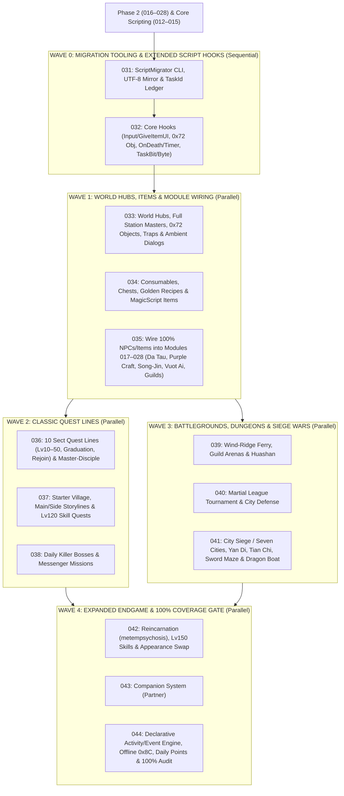

# Master Migration Plan: Legacy 6.0 Lua Scripts to C# 14 & `JX Reborn Data Standard v1` (`Phase 4: Specs 031–044`)

This **Master Migration Plan** charts the full migration of the legacy gameplay `.lua` corpus under `$LEGACY_SERVER_DIR/server1/script` onto **JXReborn's C# 14 Fluent Scripting (`JXReborn.Scripts`)** and **Declarative Data Standard (`JX Reborn Data Standard v1`)**, adhering strictly to [`.specify/memory/constitution.md`](../.specify/memory/constitution.md), [`docs/specs-roadmap.md`](specs-roadmap.md) (`001`–`030`), [`docs/data-architecture-standard.md`](data-architecture-standard.md), [`docs/testing-architecture-standard.md`](testing-architecture-standard.md), and [`docs/differential-parity-standard.md`](differential-parity-standard.md).

---

## Agreed Scope & Architectural Decisions

1. **Content Scope (Retain Full `server1` Gameplay, Strip Sim/Bot Only)**:
   - Preserve **100% of active gameplay features** in `server1/script` (**7,078 / 7,185 `.lua` files**, `22.53 MB` total source size), spanning both classic Legacy 6.0 mechanics and expanded `server1` endgame systems (*Reincarnation / Trùng Sinh*, *Level 150 Skills*, *Companion / Partner*, *Seven City Siege*, *Yan Di Treasure*, *Tian Chi Secret Realm*, *Sword Labyrinth*, *Offline Cultivation `0x8C`*, and *ActivitySys Events*).
   - **Strip only the 107 Sim/Bot overlay scripts** enumerated in [`qa/scripts/pack_legacy_profiles.py`](../qa/scripts/pack_legacy_profiles.py) (`global/nobitaxd/vdk/simcity`, `script/global/nobitaxd/vdk/simcity`, `missions/leaguematch/sims`, `global/autoingame`, `item/autoingame`, `item/vsd`, `global/vanhung1/vsd`, `battles/marshal/simtk.lua`, `missions/sevencity/bosswar.lua`, `simsevencity.lua`, `sim_guilds.lua`, `sim_siege_names.lua`, `item/tuicankhon_tudong.lua`).

2. **Migration Architecture (Parametric Scripts & Data-Driven Catalogs — Never 7,078 1:1 Classes)**:
   - Per Constitution Principle VI, **never** mechanically generate 7,078 one-to-one C# classes or embed a Lua VM in the runtime server.
   - **Parametric Consolidation**: Repeated service NPCs across 7 major cities, 8 starter villages, and 10 sect headquarters (*Blacksmith*, *Apothecary*, *Grocer*, *Station Master*, *Storage Box*, *Martial Master*, *Gold Bank*, *Event Steward*) consolidate into ~12–15 shared `sealed` C# scripts (following [`TownBlacksmithDialogScript.cs`](../src/JXReborn.Scripts/Dialogs/TownBlacksmithDialogScript.cs) and [`FactionRecruiterDialogScript.cs`](../src/JXReborn.Scripts/Factions/FactionRecruiterDialogScript.cs)).
   - **Declarative Data Extraction (`JX Reborn Data Standard v1`)**: Static ambient NPC dialogs (`路人`), signposts (`路标`), activity/event crafting recipes (`activitysys` / `tbActivity`), and static quest tables extract into schema-validated UTF-8 JSON catalogs under `data/` compiled into `MemoryPack` `.pack` snapshots.
   - **Eliminate Legacy Lua Helper Layers**: Legacy Lua 4.0 compatibility libraries (`lib/`, `dailogsys/`, `class/`, `vng_lib/`, `ui/`) are replaced directly by `FluentDialogBuilder`, `IScriptDialogContext`, and .NET 10 BCL.

3. **Roadmap Numbering (`Phase 4: Specs 031–044`)**:
   - Because `001`–`028` are complete in `specs/` and `029`–`030` are reserved for Phase 3 (`029-module-distributed-cluster`, `030-module-modern-gateway`) in [`docs/specs-roadmap.md`](specs-roadmap.md), Lua migration spans **Phase 4 (`Specs 031–044`)** without ID collisions.

---

## 1. Quantitative Inventory & 6-Bucket Taxonomy of 7,185 `.lua` Files

Auditing the full `$LEGACY_SERVER_DIR/server1/script` tree (`7,185` `.lua` files, `22.53 MB`) against exported JSON catalogs in `data/` cleanly partitions all scripts into **6 buckets**:

| Bucket | Category | File Count | Share | Migration Strategy in `JXReborn` |
| :---: | :--- | :---: | :---: | :--- |
| **0** | **Excluded Sim/Bot Overlays** | **107** | **1.5%** | Excluded per `pack_legacy_profiles.py` ignore list (`global`: 69, `missions`: 18, `item`: 17, `script`: 2, `battles`: 1). |
| **1** | **Already Compiled to JSON/Pack in Phase 1A (`001`–`011`)** | **1,736** | **24.2%** | Already covered by static data catalogs (`skill/` 926, `npclevelscript/` 58, `**/trap/*.lua` 752); audit and migrate ~35–40 custom special traps to `ITrapScript`. |
| **2** | **9 Geographic Regions (NPCs, Map Objects & Map Scripts — excl. Traps)** | **1,555** | **21.6%** | `npc/*.lua` (`1,019`), `obj/*.lua` (`278`), region helper files (`258`) -> Consolidate into `AmbientLoreDialogScript` + `data/dialogs/`, ~12 Parametric NPC Scripts, `IObjInteractionScript`, and route sect NPCs into Bucket 4. |
| **3** | **Items (`item/`), Global Core, Libraries & Utilities** | **1,225** | **17.1%** | Active `item/` (`635`), active `global/` (`404`), Lua helpers (`lib/` 51, `class/` 8, `vng_lib/` 7, `dailogsys/` 5, `ui/` 5 = `76`), small subsystems (`misc/` 41, `tagnewplayer/` 17, `changefeature/` 9, `honor/` 6, `testcase/` 6, `00ff/` 5, `maps/` 4, `gm_tool/` 3, `script_protocol/` 2, `tasktrace/` 2, 8 single-file dirs & 7 root files = `110`) -> Prune `noscript.lua` (1,598 no-op items), implement C# `IItemUsageScript` + JSON catalogs, discard Lua helper layers. |
| **4** | **Storyline Quests, Sects & Progression Systems** | **331** | **4.6%** | `task/` (`321`: `partner` 88, `newtask` 74, `tollgate` 69, `150skilltask` 61, `system` 7, `metempsychosis` 7, `newbie` 4, `random` 3, `lv120skill` 2, `fresh` 2, `killmonster` 1, `equipex` 1, root 2) + `shitu/` (`6`) + `partner/` (`4`) *(plus sect quest NPCs from Bucket 2)* -> C# 14 quest state machines + declarative JSON step tables. |
| **5** | **Missions, Battlegrounds, Guild Wars & Event Engines** | **2,231** | **31.0%** | **Missions/Instances (`1,046`)**: active `missions/` (`816`), active `battles/` (`161`), `tong/` (`65`), `nationalwar/` (`4`). **Events/Activities (`1,185`)**: `activitysys/` (`461`), `event/` (`429`), `vng_event/` (`195`), `sukien_nam/` (`34`), `vng_feature/` (`20`), plus 12 minor event folders (`46`) -> `IMissionController` + data-driven `ActivityComposeZoneModule`. |
| **Total** | **Full `server1/script` Corpus (`107` excluded + `7,078` active)** | **7,185** | **100%** | **Final Target: 100% of active `scriptPath` references resolved cleanly in C# or `data/` with zero dangling paths.** |

### Breakdown Across 9 Geographic Regions (`2,307` files = `752` traps + `1,555` Bucket 2)
- `ÖÐÔ­ÄÏÇø` (Central South): `362` files | `ÖÐÔ­±±Çø` (Central North): `354` files | `Î÷Äϱ±Çø` (Southwest North): `340` files
- `½­ÄÏÇø` (Jiangnan): `311` files | `Á½ºþÇø` (Two Lakes): `266` files | `Î÷ÄÏÄÏÇø` (Southwest South): `221` files
- `Î÷±±±±Çø` (Northwest North): `219` files | `Î÷±±ÄÏÇø` (Northwest South): `205` files | `¶«±±Çø` (Northeast): `29` files

### `scriptPath` Bindings Inside JSON Catalogs (`data/`)
- **`data/items/consumables-and-scripts.items.json`**: Contains **`5,034`** items referencing `"scriptPath"` across **`1,328`** unique paths, of which **`1,598`** items point solely to `\script\item\noscript.lua` (decorative/non-consumable items with no right-click action). Only several hundred active `MagicScript` behaviors actually require `IItemUsageScript` or `ItemScriptUsageTemplate` rules.
- **`data/npcs/*.json` & `data/maps/*.json`**: Contains **`1,346`** NPC/Trap placements specifying `"scriptPath"` or `"scriptPathOverride"` across **`792`** unique paths.

---

## 2. Engine Infrastructure, Protocol & Scripting API Gap Ledger

Scanning all **`7,078`** active `.lua` files for C-API invocation frequencies and comparing against [`IScriptDialogContext.cs`](../src/JXReborn.ZoneEngine/Scripting/IScriptDialogContext.cs) and [`ProtocolOpcodes.cs`](../src/JXReborn.Adapter.Legacy/Packets/ProtocolOpcodes.cs) identifies existing coverage plus **6 infrastructure gap groups to unlock in Wave 0 (`Spec 032`)**:

### 2.1. Already Supported APIs (`Specs 012–028`)

| Legacy Lua C-API | Call Frequency (`files`) | Equivalent in `JXReborn` |
| :--- | :---: | :--- |
| `Msg2Player` | `1,965` | `IScriptDialogContext.SendSystemMessage` |
| `Say` / `Talk` | `1,790` / `1,250` | `Say`, `Talk`, `FluentDialogBuilder` (`0x63`) |
| `Describe` / `CreateNewSayEx` | `125` / `203` | `Describe` (`OperateType = 2`, `0x63`) |
| `GetTask` / `SetTask` | `1,362` / `1,095` | `GetTask(ushort)` / `SetTask(ushort, int)` (write-behind DB persistence) |
| `GetTaskTemp` / `SetTaskTemp` | `135` / `201` | `GetTempTask(ushort)` / `SetTempTask(ushort, int)` |
| `NewWorld` / `SetFightState` / `SetPos` | `918` / `938` / `293` | `TeleportPlayerAsync(mapId, mpsX, mpsY, fightMode)` |
| `Sale` / `OpenBox` | `144` / `89` | `OpenShop(shopId, ...)` (`0x84`) / `OpenStoreBox()` (`0x88`) |
| `OpenMission` / `GetMissionV` / `SetMissionV` / `AddMSPlayer` | `38` / `280` / `200` / `45` | `IMissionController` + `IMissionContext` + `MissionZoneTickSystem` |

### 2.2. Six Gap Groups Required (Wave 0 — `Spec 032` & Wave 4)

| Group | Legacy Lua C-APIs & Frequency | Related Packets / C# Targets | Design & Verification Requirements |
| :---: | :--- | :--- | :--- |
| **G1** | **Modal Text/Number Input & Item Turn-In** `AskClientForNumber` (`50`), `AskClientForString` (`37`), `GiveItemUI` (`112`) | `s2c_scriptaction` (`0x63`) + `c2s_needcount` (`0x80`), `c2s_GiveItemBack` (`0x81`), `c2s_GiveStringBack` (`0x9F`), `c2s_scriptprotocol` (`0xAB`) | **MUST inspect `jx_linux_y` via MCP `rea` (`ghidra_12.2_PUBLIC`)** to verify exact byte offsets and `ProtocolSizeTable` entries for `0x80`/`0x81`/`0x9F`/`0xAB` plus `0x63` modal modes. Store callbacks similarly to `PlayerDialogFeatureSlot` (pre-invocation reset, clean teardown on detach/logout, strict `RuntimeItemId` ownership verification to prevent duping). |
| **G2** | **Interactive Map Static Objects** `278` `obj/*.lua` scripts (chests, steles, fruit trees, quest items) | `c2s_objmouseclick` (`0x72`, `9B`) | Add `IObjInteractionScript`, load `ScriptCode` for static ground objects from `Region_S.dat` `OBJ_SECTION`, dispatch `0x72` via `MapZoneWorker` with proximity & rate-limit guards. |
| **G3** | **Monster Death, Timer & Dynamic NPC Spawning** `OnDeath` (`393`), `OnTimer` (`158`), `AddNpc`/`AddNpcEx` (`223`), `DelNpc` (`117`), `SetNpcScript` (`111`), `SetNpcTimer` (`69`) | `JXReborn.ZoneEngine/NpcEntities/` & `Scripting/` | Add `INpcCombatScript` (`OnNpcDeathAsync`, `OnNpcTimerAsync`) and `IZoneNpcRuntimeControl` on ZoneContext enabling dynamic boss/monster spawning, `ScriptCode` assignment, expiry/respawn timers, and solo or AOI-party kill attribution. |
| **G4** | **Task Bit/Byte Helpers & Global World Vars** `GetByte`/`SetByte` (`203`/`111`), `GetBit`/`SetBit` (`88`/`100`), `GetGlbValue`/`SetGlbValue` | `IScriptDialogContext` & Control-Plane `IGlobalScriptStateService` | Implement `GetTaskByte`/`SetTaskByte` (**1-based legacy byte index `1..4`**) and `GetTaskBit`/`SetTaskBit` (**1-based bit index `1..32`**) directly on `IScriptDialogContext` to eliminate off-by-one bit bugs. Add cross-zone global state `GetGlobalValue`/`SetGlobalValue`. |
| **G5** | **Expanded Dialog/Item Context Helpers (`IScriptDialogContext`)** `AddItem` (`401`), `AddEventItem` (`280`), `AddGoldItem` (`95`), `ConsumeItem`/`DelCommonItem` (`57`/`18`), `CalcFreeItemCellCount` (`347`), `SetRevPos` (`159`), `AddRepute`/`GetRepute` (`97`/`50`), `FuYuan` (`23`), `AddLeadExp` (`15`), `GetTeamSize`/`IsCaptain`/`Msg2Team` (`103`/`31`/`21`), `AddGlobalNews`/`Msg2SubWorld` (`127`/`54`) | `ZoneScriptDialogContextBase` & `PlayerZoneState` | Add inventory-checked item grants (`TryGrantEquipment`, `TryGrantGoldItemByRowId`, `TryGrantEventItem`, `HasItemCount`), granular `RevivalPointId` (`SetRevivalPoint`), Repute/FuYuan/Leadership adjustments, party queries, and world announcements (`0xFB`). |
| **G6** | **Domain Extensions for `server1` Endgame Content (Wave 4)** `PARTNER_*` (`79` files), `ST_DoTransLife` (`5` files), `ActivitySys` (`80` files), `c2s_offlinerequest` (`0x8C`) | `JXReborn.Domain`, `JXReborn.Infrastructure`, `JXReborn.ZoneEngine` | Scoped to Specs `042`–`044`: persist Reincarnation state (`TransLifeCount` + resistance/point bonuses), Companion (`Partner`) aggregates, and Offline Cultivation / Daily Activity counters without touching core 18-Hz loop code. |

---

## 3. Semi-Automated Migration Pipeline (`tools/JXReborn.ScriptMigrator` — `Spec 031`)

The repository already ships proven Lua 4.0 parsing and decoding infrastructure under [`tools/JXReborn.DataExporter/Legacy/`](../tools/JXReborn.DataExporter/Legacy/): [`Lua4Lexer.cs`](../tools/JXReborn.DataExporter/Legacy/Lua4Lexer.cs), [`Lua4Interpreter.cs`](../tools/JXReborn.DataExporter/Legacy/Lua4Interpreter.cs), [`HybridLegacyTextDecoder.cs`](../tools/JXReborn.DataExporter/Legacy/HybridLegacyTextDecoder.cs), [`LegacyTrapScriptScanner.cs`](../tools/JXReborn.DataExporter/Legacy/LegacyTrapScriptScanner.cs), and [`PakFilePathHasher.cs`](../tools/JXReborn.DataExporter/Legacy/PakFilePathHasher.cs). Building upon it, `tools/JXReborn.ScriptMigrator` automates **4 tasks**:

1. **UTF-8 Mirror Exporter (`export-utf8-mirror`)**:
   - Reads all `7,078` active `.lua` scripts (handling both GBK-encoded directory filenames and escaped decimal string literals `\186\224...` in TCVN3/GBK) and writes readable UTF-8 copies into gitignored `artifacts/lua-utf8-mirror/` so developers and AI agents read dialogs accurately.
2. **Global `TaskId` / `TempTaskId` / `GlobalValue` Ledger (`extract-task-ledger`)**:
   - Scans AST/tokens across all `GetTask`/`SetTask`/`GetByte`/`SetBit`/`GetTaskTemp`/`GetGlbValue` calls (resolving `TSK_*` constants) to emit a single unified ID registry (`docs/generated/lua-task-id-registry.md`), preventing any `TaskId` collisions across quests, sects, reincarnation, and events.
3. **Static Dialog & Declarative Event Extractor (`extract-data-catalogs`)**:
   - Detects pure `Talk`/`Say` NPC/object scripts (with zero `Task` branching) under `**/npc/*.lua` and `**/obj/*.lua`, exporting them cleanly to `data/dialogs/ambient-npcs.dialogs.json`.
   - Evaluates declarative `tbActivity` / `Compose` tables to generate `data/events/*.events.json`.
4. **100% Script Coverage Auditor (`audit-coverage`)**:
   - Verifies every one of the `792` NPC/Trap script references in `data/npcs/` & `data/maps/`, `1,328` item script references in `data/items/` (excluding `noscript.lua`), and `7,078` active Lua files against `ScriptRegistrySnapshot` + JSON catalogs, failing on any broken link.

---

## 4. Wave-Based Execution Roadmap (`Phase 4: Specs 031–044`)

### Dependency Graph

### Detailed Catalog of All 14 Specifications (`031`–`044`)

| Wave | Spec ID | Target Spec Directory | Source Lua Scope | `JXReborn` Deliverables & Verification Gates |
| :---: | :---: | :--- | :--- | :--- |
| **0** | **`031`** | `specs/031-tooling-lua-audit-and-utf8-ledger` | All `7,185` `.lua` files (`skill/` 926, `npclevelscript/` 58, `trap/` 752 audit) | `tools/JXReborn.ScriptMigrator`, gitignored UTF-8 mirror, `lua-task-id-registry.md`, Phase 1A coverage ledger. |
| **0** | **`032`** | `specs/032-core-scripting-hooks-and-modals` | Core API gaps (`AskClientFor*`, `GiveItemUI`, `0x72`, `OnDeath`/`OnTimer`, `AddNpc`, `GetByte`/`Bit`) | Inspect `jx_linux_y` via MCP `rea` for `0x80`/`0x81`/`0x9F`/`0xAB` & `0x63` modals; extend `IZoneScriptHost`, `IScriptDialogContext`, `IObjInteractionScript`, `INpcCombatScript`; `ZoneSimulationHarness` + Golden Wire Vectors. |
| **1** | **`033`** | `specs/033-scripts-world-hubs-and-ambient` | 9 regions (`npc/` `1,019`, `obj/` `278`, custom `trap/`) + service NPCs in `global/` | `data/dialogs/ambient-npcs.dialogs.json` + `AmbientLoreDialogScript`, full `TownTeleporterDialogScript` (7 cities, 8 villages, 10 sects, training caves), `MapBoxObjectScript` (`0x72`), Banks, Stewards, Grocers, Stables, ~35–40 `ITrapScript`. |
| **1** | **`034`** | `specs/034-scripts-consumables-and-chests` | Active `item/` (`635`, excl. `noscript.lua`) + `shop/` | Migrate buff/duration consumables (*Tiên Thảo Lộ*, *Quế Hoa Tửu*, *Thiên Sơn Bảo Lộ*), EXP/FuYuan jars, *Thần Hành Phù*, chests, Golden recipes (`huangjin_tupu`), starter gift packs to `IItemUsageScript` + JSON catalogs. |
| **1** | **`035`** | `specs/035-scripts-existing-modules-wiring` | Scripts wiring into `017`–`028` (`global/`, `item/`, `task/newtask/master*`, `smeltsystem/`) | Full *Dã Tẩu* NPC dialogs, Purple Blacksmith & Golden Reforge (`smeltupgrade`), *Vượt Ải* NPC, *Song-Jin* Recruiters/Quartermasters, Guild Receptionists, World Boss announcements (`026`). |
| **2** | **`036`** | `specs/036-scripts-ten-sects-quests` | 10-sect quest NPCs across 9 regions + `shitu/` (`6`) | 10 sect quest modules (`10x`–`50x`, graduation, rejoin, named disciple, `10x`–`60x` quest skill unlocks) + Master-Disciple (`shitu`) with per-sect parity verification. |
| **2** | **`037`** | `specs/037-scripts-storyline-quests` | `task/newtask/` (main/branch), `task/newbie/`, `task/fresh/`, `task/lv120skill/`, `task/system/` | Starter village tutorial quests, Main Golden Quest chains (Justice/Evil/Balance), Side Repute/Item chains, and Level 120 skill quest using `INpcCombatScript` (`OnDeath`) and `GiveItemUI`. |
| **2** | **`038`** | `specs/038-module-killer-and-messenger` | `task/tollgate/` (`69`: `killer/` & `messenger/`) + `task/killmonster/`, `task/random/` | Daily Killer Boss hunts (accept bounty, summon/defeat Lv90 field boss, drop *Sát Thủ Giản*) & Messenger missions (*Phong Kỳ*, *Sơn Thần Miếu*, *Thiên Bảo Khố*) feeding *Vượt Ải* & Guild progression. |
| **3** | **`039`** | `specs/039-module-ferry-and-arenas` | `missions/fengling_ferry/` (`11`), `missions/bw/` (`10`), `bairenleitai/` (`10`), `huashanqunzhan/` (`26`), `new_qiecuo/` (`4`) | `IMissionController` instances for *Phong Lăng Độ* Ferry (3 docks, hourly departures, Water Bandit Boss), Arena duels / Guild matches, and Huashan Great Battle. |
| **3** | **`040`** | `specs/040-module-leaguematch-and-defence` | `missions/leaguematch/` (`42` active), `newcitydefence/` (`71`), `citydefence/` (`24`), `championship/` (`24`), `freshman_match/` (`24`) | Martial League tournaments (1v1/2v2/3v3/5v5, rankings, Honor exchange) and City Defense events (wave sieges, defensive mines/traps). |
| **3** | **`041`** | `specs/041-module-citywar-and-dungeons` | `missions/citywar_*` (`46`), `sevencity/` (`16` active), `tong/` (`65`), `yandibaozang/` (`24`), `tianchimijing/` (`46`), `maze/` (`48`), `dragonboat/` (`9`), `datusha/` (`9`), `qianchonglou/` (`11`) | Full City Siege & Seven-City Warfare (Dragon Pillar capture, city taxation, Emperor `nationalwar/`), plus major instances (*Viêm Đế*, *Thiên Trì*, *Kiếm Gia Mê Cung*, Dragon Boat Race, expanded Song-Jin). |
| **4** | **`042`** | `specs/042-module-translife-and-150skills` | `task/metempsychosis/` (`7`), `task/150skilltask/` (`61`), `changefeature/` (`9`), `honor/` (`6`), `task/equipex/` (`1`) | Domain/EF Core `TransLifeCount` + resistance/stat bonuses from Reincarnation; Lv150 skill questlines & skill books (`150skilltask`); equipment visual transformation (`changefeature`). |
| **4** | **`043`** | `specs/043-module-companion-partners` | `task/partner/` (`88`), `partner/` (`4`), `partner_*` items | Domain aggregate + Zone runtime for Companions (summon/dismiss, personality traits, leveling, companion quests, `partner_skillbook_learnt`). |
| **4** | **`044`** | `specs/044-module-activity-and-events` | `activitysys/` (`461`), `event/` (`429`), `vng_event/` (`195`), `sukien_nam/` (`34`), `vng_feature/` (`20`), `huoyuedu/` (`3`), `offline_benguyet/` (`2`), `flipcard/` (`2`), etc. | Declarative Event Engine (`ActivityComposeZoneModule` + `data/events/*.events.json`: daily/weekly schedules, preconditions, craft/exchange formulas, usage caps), Offline Cultivation (`0x8C`), Daily Activity Points, Card Flip, and **100% Audit Gate across all 7,078 files**. |

---

## 5. Execution Process & 4-Tier Verification Gates (`J17+`)

Each Specification across `031`–`044` reaches `Converged` status only after completing the full **SpecKit workflow** and passing all **4 verification gates**:

1. **SpecKit + `/teamwork` Execution Discipline**:
   - Parallel waves (Waves 1–4) run **1 Spec = 1 Team** inside isolated **Git Worktrees (`workspace: "share"`)** with `SPECIFY_FEATURE_DIRECTORY=specs/03X-...` to prevent conflicts on `.specify/feature.json`.
   - Required flow: `/speckit-specify` -> `/speckit-plan` -> `/speckit-tasks` -> `/speckit-analyze` -> `/speckit-implement` -> `/speckit-converge`.
   - Strict `JXReborn.Scripts` standards: 1 type/file, `sealed` concrete classes, stateless singletons for NPC/Item/Trap/Obj scripts, zero blocking I/O on the 18-Hz tick thread, zero warnings (`TreatWarningsAsErrors=true`), and green `SolutionArchitectureComplianceTests`.

2. **Four Mandatory Verification Gates**:
   - **Gate 1 — Binary Protocol Contracts & Golden Wire Vectors (`tests/JXReborn.Protocol.Tests`)**: Every new Wave 0 opcode (`0x80`, `0x81`, `0x9F`, `0xAB`, `0x72`, `0x8C`, `0x63` modal variants) MUST be verified directly against `$LEGACY_SERVER_DIR/server1/jx_linux_y` using `ghidra_12.2_PUBLIC` (MCP `rea`) to extract independent literal byte vectors prior to coding serializers/parsers.
   - **Gate 2 — 18-Hz Zone Simulation & Fault Isolation (`tests/JXReborn.ZoneEngine.Tests`)**: All dialogs, `TaskId`/`TaskByte`/`TaskBit` branches, inventory checks, `OnDeath`/`OnTimer` monster events, `IMissionController` lifecycles, and `CollectibleScriptLoadContext` hot-reloads MUST have deterministic `ZoneSimulationHarness` tests (no `Task.Delay`/`Thread.Sleep`, proving script exceptions stay isolated per session).
   - **Gate 3 — Extended Live `game.exe` & `jx-runtime-standalone` Parity (`J17+` in `qa/JXReborn.ClientDriver.Tests`)**: Extending `J01`–`J16` in [`docs/parity-journeys-backlog.md`](parity-journeys-backlog.md), add Journeys `J17`–`J28` run via `.\qa\scripts\run-parity.ps1`:
     - `J17`: Number/string modal inputs (`AskClientForNumber`/`String`), item submission (`GiveItemUI`), map object click (`0x72`).
     - `J18`–`J19`: Inter-city Station Master network, buff consumables & chests, Blacksmith Golden Reforge.
     - `J20`–`J22`: Starter quests, 10-Sect quests (`10x`–`50x` + graduation), Main Golden storyline, Daily Killer Boss & Messenger missions.
     - `J23`–`J25`: *Phong Lăng Độ* Ferry, Martial League, City Siege / *Viêm Đế* / *Thiên Trì*.
     - `J26`–`J28`: Reincarnation + Lv150 Skills, Companions, ActivitySys / Offline Cultivation.
   - **Gate 4 — Automated 100% Script Coverage Compliance (`ScriptCoverageComplianceTests`)**: Automatically scans `data/npcs/`, `data/maps/`, `data/items/` in CI to enforce **0 broken `scriptPath` links** (excluding `noscript.lua`) and **100% verified coverage across all 7,078 active `.lua` files** (via C# script, JSON catalog, or parametric consolidation).
