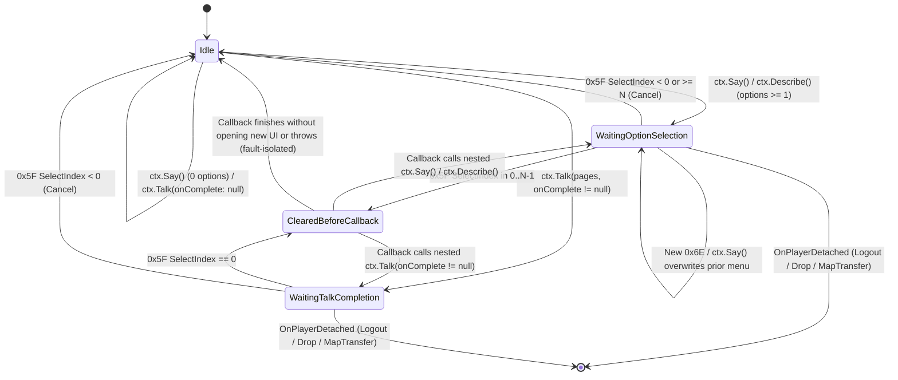

# Data Model: Gameplay Scripting Host & Interactive Dialog System (`012`)

**Feature Branch**: `012-core-csharp-scripting-host`  
**Date**: 2026-11-11  
**Spec**: [spec.md](spec.md) | **Research**: [research.md](research.md)

---

## 1. Static Asset Extensions (`JX Reborn Data Standard v1` & `JXReborn.GameAssets`)

### 1.1 `ItemGenreKind` Alignment (`JXReborn.Primitives.Items`)

| Member | Numeric Value | Legacy Genre / Schema Mapping | Zone Handling |
| :--- | :---: | :--- | :--- |
| `Equipment` | `0` | `item_equip` (`0`) | 15-slot paper doll equip (`008`) |
| `Medicine` | `1` | `item_medicine` (`1`) | Instant/gradual vital recovery (`008`) |
| `QuestKey` | `4` | `item_task` (`4`, legacy alias `2` supported in importer) | Non-usable quest token inspected by scripts |
| `TownPortal` | `3` | `item_townportal` (`3` / `5`) | Revival-point teleport (`008`) |
| `MagicScript` | `6` | `item_magicscript` (`6`) | **Routed to `IZoneScriptHost` (`012`)** |
| `PlatinaEquipment` | `7` | `item_platinaequip` (`7`) | Platina tier equipment |

### 1.2 `ItemScriptUsageTemplate` (`JXReborn.GameAssets.Items`)

Immutable `[MemoryPackable]` sub-record attached optionally to `ItemTemplate.ScriptUsage`:

| Property | Type | Constraints / Default | Purpose |
| :--- | :--- | :--- | :--- |
| `ScriptCode` | `string?` | Optional `kebab-case` identifier (`^[a-z0-9]+(-[a-z0-9]+)*$`) | Resolves `IItemUsageScript` in `IZoneScriptHost` |
| `CastSkillId` | `int` | `>= 0` (default `0`) | Fallback skill ID triggered when `ScriptCode` is null/empty (`FR-008`) |
| `CastSkillLevel` | `ushort` | `1..60` (default `1`) | Skill level used for fallback skill execution |
| `MinRequiredLevel` | `ushort` | `1..255` (default `1`) | Optional declarative character level gate checked before script/skill execution |
| `ConsumeOnSkillFallback` | `bool` | Default `true` | Whether fallback skill activation consumes 1 stack unit |

### 1.3 `StaticNpcSpawnTemplate` & `NpcZoneState` Dialog Binding

| Entity | Added Property | Type | Constraints / Default | Purpose |
| :--- | :--- | :--- | :--- | :--- |
| `StaticNpcSpawnTemplate` | `ScriptCode` | `string?` | Optional `kebab-case` code (default `null`) | Canonical C# script binding replacing legacy Lua `ScriptPath` |
| `StaticNpcSpawnTemplate` | `DialogRadiusCells` | `byte` | `1..16` (default `4`) | Conversational base radius in 32x32 cells |
| `NpcZoneState` | `ScriptCode` | `string` | Normalized UTF-8 `kebab-case` (`""` if unbound) | Runtime lookup key in `IZoneScriptHost.TryGetNpcDialogScript` |
| `NpcZoneState` | `DialogRadiusCells` | `byte` | `1..16` (default `4`) | Enforces `distanceMps <= (DialogRadiusCells * 32) * 2` (`256` Mps default) |

### 1.4 `PortalTrapActionKind` & `PortalTrapBindingTemplate`

- `PortalTrapActionKind` (`src/JXReborn.Primitives/WorldZones/PortalTrapActionKind.cs`):
  - `ToggleFightStateAndSetPos = 1`
  - `ChangeMapPortal = 2`
  - **`CustomScript = 3`** *(Added in `012`)*
- `PortalTrapBindingTemplate` (`src/JXReborn.GameAssets/WorldMaps/PortalTrapBindingTemplate.cs`):
  - Adds `string? ScriptCode = null` (`[MemoryPackable]` trailing optional parameter). When `ActionKind == PortalTrapActionKind.CustomScript` and `ScriptCode` is non-empty, `MapZoneWorker.EvaluatePlayerTrapAsync` invokes `IZoneScriptHost.TryGetTrapScript(binding.ScriptCode, out ITrapScript? trapScript)`.

---

## 2. Runtime Scripting & Session State (`JXReborn.ZoneEngine` & `JXReborn.Scripts`)

### 2.1 `ScriptRegistrySnapshot` (`JXReborn.Scripts.Hosting`)

Immutable thread-safe lookup snapshot swapped atomically via `Interlocked.Exchange`:

| Field | Type | Key Format | Description |
| :--- | :--- | :--- | :--- |
| `Generation` | `long` | Monotonic `1, 2, ...` | Incremented on each successful reload |
| `LoadedAtUtc` | `DateTimeOffset` | UTC timestamp | Diagnostic timestamp of snapshot activation |
| `NpcDialogScripts` | `FrozenDictionary<string, INpcDialogScript>` | `Ordinal` `kebab-case` | Registered NPC dialog scripts (e.g., `"npc-town-teleporter"`) |
| `ItemUsageScripts` | `FrozenDictionary<string, IItemUsageScript>` | `Ordinal` `kebab-case` | Registered usable item scripts (e.g., `"item-beginner-gift-pack"`) |
| `TrapScripts` | `FrozenDictionary<string, ITrapScript>` | `Ordinal` `kebab-case` | Registered custom map cell trap scripts |
| `MissionFactories` | `FrozenDictionary<string, Func<IMissionController>>` | `Ordinal` `kebab-case` | Per-zone mission controller factories |
| `LoadContextRef` | `WeakReference?` | Optional | Tracks collectible `AssemblyLoadContext` for unload verification |

**Validation Invariants**:
- Every registered `ScriptCode` MUST be non-empty, lowercase `kebab-case` (`[a-z0-9-]`), and unique within its script category; duplicate codes fail bundle validation before swap.

---

### 2.2 `PlayerDialogFeatureSlot` (`JXReborn.ZoneEngine.Scripting`)

Attached lazily to `PlayerZoneState` via `PlayerFeatureSlotKey<PlayerDialogFeatureSlot>` registered by `ScriptingZoneModule` (`IPlayerFeatureSlot`):

| Property / Field | Type | Lifecycle / Constraints | Description |
| :--- | :--- | :--- | :--- |
| `PendingState` | `PendingDialogKind` (`byte`) | `None = 0`, `WaitingOptionSelection = 1`, `WaitingTalkCompletion = 2` | Current server-authoritative UI wait mode |
| `SourceNpcId` | `uint` | `0` when item-initiated, else runtime `NpcId` | Enables optional NPC proximity/liveness re-verification |
| `OpenedAtFrame` | `long` | 18-Hz `ZoneExecutionContext.CurrentFrame` | Diagnostic / stale-dialog tracking |
| `_optionCallbacks` | `Func<IScriptDialogContext, ValueTask>?[]` | Length `0..50` (`MaxDialogOptions = 50`) | Server-only option callbacks; nulled immediately upon consumption/cancel |
| `_optionCount` | `int` | `0..50` | Number of active selectable options |
| `_talkCompletedCallback` | `Func<IScriptDialogContext, ValueTask>?` | Nullable continuation | Invoked when `PendingState == WaitingTalkCompletion` and `SelectIndex == 0` |
| `_tempTaskValues` | `Dictionary<ushort, int>` | `0..65535` -> `int32` (non-zero entries stored) | Session-volatile quest/script scratchpad; cleared in `OnPlayerDetached` |

#### Pending Dialog State Machine

---

### 2.3 Persistent `TaskValues` vs. Session-Volatile `TempTaskValues`

| Dimension | Persistent Quest Variable (`TaskValues`) | Temporary Session Variable (`TempTaskValues`) |
| :--- | :--- | :--- |
| **Legacy Equivalent** | Persistent `GetTask` / `SetTask` slots | Session-volatile `GetTaskTemp` / `SetTaskTemp` slots |
| **Key Type & Range** | `ushort` (`0..65535`) | `ushort` (`0..65535`) |
| **Value Type** | `int` (`Int32.MinValue..Int32.MaxValue`, default `0`) | `int` (`Int32.MinValue..Int32.MaxValue`, default `0`) |
| **Runtime Owner** | `PlayerZoneState._taskValues` (`PlayerZoneState.cs:23,204-234`) | `PlayerDialogFeatureSlot._tempTaskValues` |
| **Zero-Value Sparsity** | Setting `0` removes key from dictionary (`PlayerZoneState.cs:209-211`) | Setting `0` removes key from dictionary |
| **Cross-Zone Transfer** | Preserved in `UpdateCharacterWorldSnapshotDto` / handoff payload | Cleared on zone detach unless explicitly persisted as `TaskValue` |
| **Database Persistence** | Persisted in `Character.TaskValues` (`Character.cs:15,103`) | **Never persisted**; wiped on disconnect/logout (`FR-006`, `FR-009`) |

---

### 2.4 `ActiveZoneMissionSlot` (`JXReborn.Scripts.Missions`)

Per-zone runtime state managed inside `ZoneExecutionContext` (via `GetOrCreateZoneFeature`) and stepped by `MissionZoneTickSystem`:

| Property | Type | Constraints | Description |
| :--- | :--- | :--- | :--- |
| `MissionCode` | `string` | Non-empty `kebab-case` | Identifier of the active `IMissionController` |
| `Controller` | `IMissionController` | Non-null instance | Active mission lifecycle controller for this map shard |
| `StartedAtFrame` | `long` | `>= 1` | Zone tick frame when `OnMissionStartAsync` ran |
| `TimerIntervalFrames` | `int` | `>= 1` (e.g., `18` = 1s, `180` = 10s) | Periodic interval between `OnMissionTimerTickAsync` calls |
| `NextTimerTickFrame` | `long` | `>= StartedAtFrame` | Next 18-Hz frame at which `OnMissionTimerTickAsync` fires |
| `PhaseId` | `int` | Default `0` | Mission-defined state phase (`Preparation = 1`, `Active = 2`, `Settlement = 3`) |
| `Participants` | `Dictionary<Guid, byte>` | `CharacterId -> GroupCampId` | Enrolled players automatically cleaned up on zone detach |
| `MissionValues` | `Dictionary<ushort, int>` | `0..65535 -> int32` | Per-mission shared counters (scores, boss waves, remaining spawns) |

---

## 3. Domain Validation Invariants Summary

1. **Zero Callback Wire Exposure (`FR-004`)**: `ScriptActionS2CPacket` (`0x63`) accepts only `string PromptUtf8` and `IReadOnlyList<string> OptionsUtf8` (or `PagesUtf8`). Delegate references (`DialogOption.Callback`) never leave `JXReborn.ZoneEngine` / `JXReborn.Scripts`.
2. **Option Count & Payload Budget (`FR-003`)**:
   - Maximum selectable options per menu: `50` (`ScriptingConsts.MaxDialogOptions = 50`). Excess options are truncated at `50` with a structured warning log.
   - Maximum `m_pContent` TCVN3 byte length per `0x63` frame: `900` bytes (`ScriptingConsts.MaxScriptActionContentBytes = 900`).
3. **Explicit Item Consumption (`FR-007`, `FR-014`)**:
   - `ItemUsageResult.ConsumeOne` deducts `1` from stack (or removes single-stack item and sends `0x60` `s2c_removeitem`).
   - `ItemUsageResult.KeepItem` or any caught `Exception` leaves stack count untouched.
4. **Non-Pinning Collectible Unload (`FR-013`, `SC-005`)**:
   - `PlayerDialogFeatureSlot.ClearPendingDialog()` nulls every element in `_optionCallbacks` and `_talkCompletedCallback` so collectible script closures cannot remain reachable from `PlayerZoneState` once an interaction ends or detaches.
