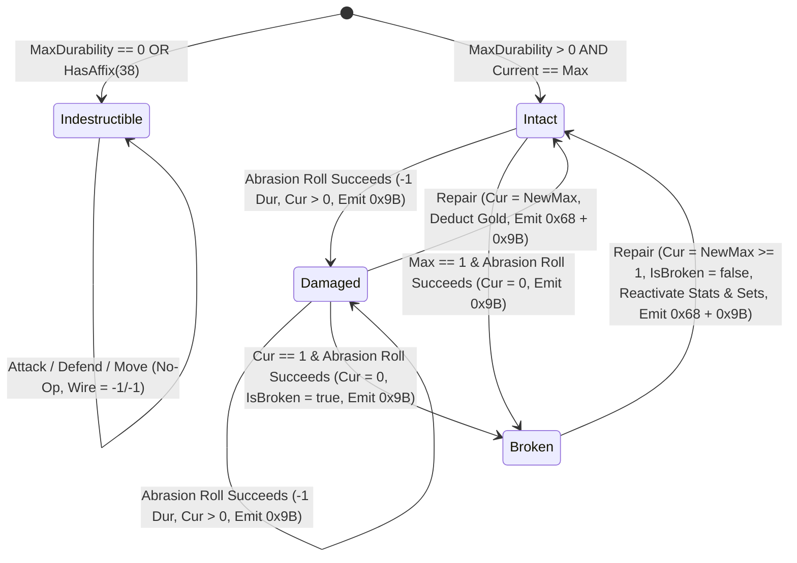

# Data Model: Core Equipment Durability, Golden Gear & Set Bonuses

**Feature Branch**: `013-core-equipment-durability-and-sets`  
**Date**: 2026-11-11  
**Spec**: [spec.md](spec.md) | **Plan**: [plan.md](plan.md)

---

## 1. Primitives & Constants (`JXReborn.Primitives/Items/`)

| Type Name | File Path | Kind | Members & Ground-Truth Values |
| :--- | :--- | :---: | :--- |
| `EquipmentAbradeKind` | `src/JXReborn.Primitives/Items/EquipmentAbradeKind.cs` | `enum : byte` | `Attack = 0` (`enumAbradeAttack`), `Defend = 1` (`enumAbradeDefend`), `Move = 2` (`enumAbradeMove`). |
| `EquipmentAbrasionConsts` | `src/JXReborn.Primitives/Items/EquipmentAbrasionConsts.cs` | `static class` | `WeaponAttackRange = 256`, `ArmorDefendRange = 320`, `BootsMoveRange = 2560`, `HorseMoveRange = 5120`, `DurabilityAttributeId = 31` (`durability_v`), `IndestructibleAttributeId = 38` (`indestructible_b`), `NormalRepairItemPriceScale = 50`, `NormalRepairMagicPriceScale = 16`, `GoldenCheapRepairLevelMultiplier = 10`, `GoldenCostlyRepairMultiplier = 3`, `GoldenCheapRepairLostDurabilityDivisor = 10`, `WireIndestructibleDurability = -1`. |

---

## 2. Static Asset Templates (`JXReborn.GameAssets/Items/` & `Snapshots/`)

### 2.1 `GoldenFixedAffixBindingTemplate` (`[MemoryPackable] public sealed partial record`)
Represents one fixed magic affix slot (`0..5`) on a named Golden item from `data/items/golden-equipment.items.json` (`fixedMagicAffixes`):
- `int SlotIndex` (`0..5`; `0, 2, 4` explicit; `1, 3, 5` hidden)
- `int AffixRowId` (`1`-based row ID in `magic-affixes.items.json` under `affixPool: "goldenFixed"`)
- `bool IsHiddenSeriesSlot` (`true` for odd indices `1, 3, 5`)
- `short AttributeId` (numeric magic attribute ID, e.g., `85`, `89`, `102`, `126`, `139`)
- `string AttributeCode` (UTF-8 code, e.g., `"vitality_v"`, `"lifemax_p"`)
- `int Param0Min`, `int Param0Max`
- `int Param1Min = -1`, `int Param1Max = -1`
- `int Param2Min = 0`, `int Param2Max = 0`

### 2.2 `EquipmentSuiteBindingTemplate` (`[MemoryPackable] public sealed partial record`)
Represents set membership metadata attached to an `ItemTemplate` (`suiteBinding` in `golden-equipment.items.json`):
- `int SuiteId` (`> 0` for System A Classic Golden Suite membership; `0` if none)
- `int ExtSuiteId` (`> 0` for System B Extended Suite membership; `0` if none)
- `int ExtSuitePieceIndex` (piece slot index within `ExtSuiteId`, preventing duplicate piece stacking)
- `IReadOnlyList<int> ExtHiddenAffixIds` (typically `[affixId0, affixId1]` in `"goldenFixed"` pool unlocked at partial/full Extended Suite thresholds)

### 2.3 `EquipmentSetTemplate` (`[MemoryPackable] public sealed partial record`)
Represents a Classic (`IsExtendedSuite == false`) or Extended (`IsExtendedSuite == true`) equipment set from `data/items/sets-objects-recipes.items.json` (`equipmentSets`) or synthesized by `ReBuildGoldEquipmentSuite` (`suiteId 1..82`):
- `int Id` (`suiteId` when `!IsExtendedSuite`, `extSuiteId` when `IsExtendedSuite`; indexed by composite key `(bool IsExtendedSuite, int Id)`)
- `string Code` (`kebab-case`, e.g., `"bo-thanh-cau-83"` or `"ext-bo-mo-rong-mong-long-1"`)
- `string Name` (UTF-8 display name)
- `bool IsExtendedSuite`
- `int PieceCount` (full completion threshold `1..15`)
- `int PartialPieceCount` (`> 0` for Extended Suites with a `1`-affix partial threshold, e.g., `3`; `0` for Classic Suites)
- `int PartialUnlockedSlots` (`1` for Extended partial threshold; `0` otherwise)
- `int FullUnlockedSlots` (`3` for Classic Suites unlocking hidden slots `1, 3, 5`; `2` for Extended Suites unlocking `ExtHiddenAffixIds[0..1]`)

### 2.4 Extended `ItemTemplate` & `GameAssetsSnapshotBundle`
- **`ItemTemplate`**: Adds optional default-valued parameters preserving existing call sites:
  - `int RowId = 0` (`1`-based catalog `rowId` from JSON; equals `goldequip.txt` 1-based row for `Quality == Golden`)
  - `IReadOnlyList<GoldenFixedAffixBindingTemplate>? FixedMagicAffixes = null`
  - `EquipmentSuiteBindingTemplate? SuiteBinding = null`
- **`GameAssetsSnapshotBundle`**: Appends `IReadOnlyList<EquipmentSetTemplate>? EquipmentSets = null` so `MemoryPackSnapshotCompiler` and `GameAssetsSnapshotLoader` serialize/deserialize all set definitions in `artifacts/jxreborn-data.pack`.

---

## 3. Domain, Contracts & Runtime Entities

### 3.1 Control-Plane Persistence (`CharacterItem` & `CharacterItemDto`)
- **`CharacterItem`** (`src/JXReborn.Domain/Characters/CharacterItem.cs`):
  - Adds `public ushort GoldRowId { get; private set; }` (default `0`; `>= 1` for `Quality == ItemQualityKind.Golden`), mapped in `JXRebornDbContext` (`HasDefaultValue((ushort)0)`).
  - Fixes `SetDurability(ushort currentDurability, ushort? maxDurability = null)`:
    ```csharp
    if (maxDurability.HasValue)
    {
        MaxDurability = maxDurability.Value;
    }

    CurrentDurability = currentDurability;
    IsBroken = MaxDurability > 0 && currentDurability == 0;
    ```
    Ensuring `IsBroken` transitions `true -> false` whenever `currentDurability > 0`!
- **`CharacterItemDto`** (`src/JXReborn.Contracts/Characters/CharacterItemDto.cs`):
  - Appends `ushort GoldRowId = 0` and maps cleanly in `CharacterAppService` (`ApplyWorldSnapshot` and `SessionLeaseAppService.MapToDto`).

### 3.2 Zone Simulation Slot (`PlayerItemSlot`)
`src/JXReborn.ZoneEngine/Items/PlayerItemSlot.cs`:
- **`ushort GoldRowId { get; }`**: `1`-based Golden catalog row ID (`0` for non-Golden items). Note: `DetailType` remains the canonical equipment slot type (`0..14`, e.g., `7` for Helm, `2` for Body Armor) so `PlayerInventoryGrid.IsMatchingEquipmentSlot` works uniformly across Normal, Blue, Purple, and Golden gear!
- **`bool IsIndestructible`**: Computed property returning `true` when:
  1. `Genre != ItemGenreKind.Equipment && Genre != ItemGenreKind.PlatinaEquipment`, OR
  2. `MaxDurability == 0` (template lacks `durability_v` `attributeId == 31`), OR
  3. Any slot in `MagicAttributes[0..5]` has `AttributeId == EquipmentAbrasionConsts.IndestructibleAttributeId` (`38`, `indestructible_b`).
- **`void SetDurability(ushort currentDurability, ushort? maxDurability = null)`**:
  Updates `MaxDurability` (if provided) and `CurrentDurability`, and sets `IsBroken = !IsIndestructible && MaxDurability > 0 && currentDurability == 0;`.
- **`void Repair(ushort newCurrentDurability, ushort newMaxDurability)`**:
  Delegates to `SetDurability(newCurrentDurability, newMaxDurability)`, guaranteeing `CurrentDurability == newMaxDurability > 0` and `IsBroken == false`.

### 3.3 Outbound Wire Snapshot (`PlayerItemSyncSnapshot`)
`src/JXReborn.ZoneEngine/PlayerSessions/PlayerItemSyncSnapshot.cs`:
- Adds `ushort GoldRowId = 0`.
- `CreateFromSlot(PlayerItemSlot slot)` computes:
  - `MaxDurability`: `slot.IsIndestructible ? (short)-1 : (short)Math.Clamp((int)slot.MaxDurability, 0, short.MaxValue)`
  - `CurrentDurability`: `slot.IsIndestructible ? (short)-1 : (short)Math.Clamp((int)slot.CurrentDurability, 0, short.MaxValue)`
  - `GoldRowId`: `slot.Quality == ItemQualityKind.Golden ? slot.GoldRowId : (ushort)0`

---

## 4. State Transitions

### 4.1 Equipment Durability Lifecycle State Machine



**Broken State Invariants (`IsBroken == true`)**:
1. Remains in `ItemContainerPlace.Equip` if equipped when `CurrentDurability` hits `0` (never auto-dropped or forced onto `Hand`).
2. `0%` of `Template.BaseAttributes`, `0%` of `MagicAttributes[0..5]`, `0` Five-Elements adjacency generation, and `0` Classic/Extended set piece count contribution.
3. Player `CurrentLife`, `CurrentMana`, and `CurrentStamina` immediately clamp to lowered `EffectiveMaxLife`, `EffectiveMaxMana`, and `EffectiveMaxStamina`.
4. Cannot be equipped via `MoveInventoryItemZoneCommand` (`CanEquipItem == false`) if unequipped into `EquipRoom`.

### 4.2 Set Bonus Activation Evaluation Order (`PlayerInventoryGrid`)

On every equip, unequip, item break (`1 -> 0`), or equipped item repair (`0 -> Max`), `RecalculateEquipmentAndFiveElementsActivation(player)` executes in four deterministic, zero-allocation passes:

1. **Pass 1 — Count Distinct Non-Broken Set Pieces**:
   - **Classic Suites (`suiteId > 0`)**: Count distinct `(suiteId, effectiveGoldRowId)` across `_equipSlots[0..14]` where `equip is not null && !equip.IsBroken`.
   - **Extended Suites (`extSuiteId > 0`)**: Count distinct `(extSuiteId, extSuitePieceIndex)` across `_equipSlots[0..14]` where `equip is not null && !equip.IsBroken`.
2. **Pass 2 — Activate Hidden Slots (`1, 3, 5`) Per Intact Equipped Piece**:
   - If `equip.Template.SuiteBinding?.SuiteId > 0` and `classicCount >= catalog.GetClassicSuiteRequiredPieces(suiteId)` (`> 0`):
     `equip.ActiveHiddenSlots[0] = equip.ActiveHiddenSlots[1] = equip.ActiveHiddenSlots[2] = true;`
   - Else: evaluate standard `ActivatingPartsByEquipSlot` Five-Elements `Generates` links using only non-broken adjacent items (`!itemA.IsBroken`, `!itemB.IsBroken`).
3. **Pass 3 — Aggregate Base + Explicit (`0, 2, 4`) + Active Hidden (`1, 3, 5`) + Extended Suite Bonus Affixes**:
   - Apply `Template.BaseAttributes` and active `MagicAttributes[0..5]`.
   - If `equip.Template.SuiteBinding?.ExtSuiteId > 0` and `catalog.TryGetEquipmentSet(isExtendedSuite: true, extSuiteId, out extSet)`:
     - If `extCount >= extSet.PartialPieceCount` (`> 0`) and `ExtHiddenAffixIds.Count >= 1`: apply `"goldenFixed"` affix `ExtHiddenAffixIds[0]`.
     - If `extCount >= extSet.PieceCount` (`> 0`) and `ExtHiddenAffixIds.Count >= 2`: apply `"goldenFixed"` affix `ExtHiddenAffixIds[1]`.
4. **Pass 4 — Clamp Player Vitals**:
   - Clamp `player.CurrentLife` (when `CurrentLife > 0`), `player.CurrentMana`, and `player.CurrentStamina` so none exceed the newly computed `EffectiveMaxLife`, `EffectiveMaxMana`, and `EffectiveMaxStamina`.
