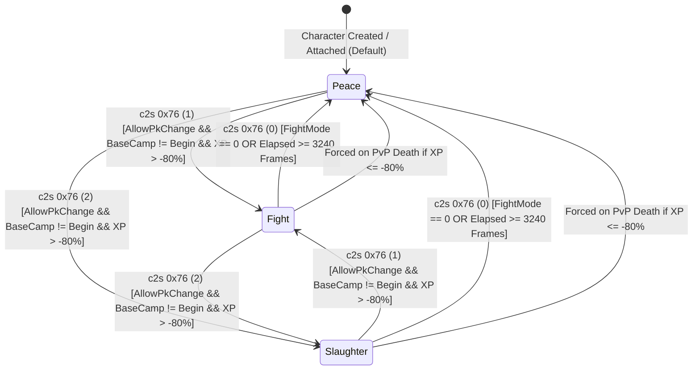
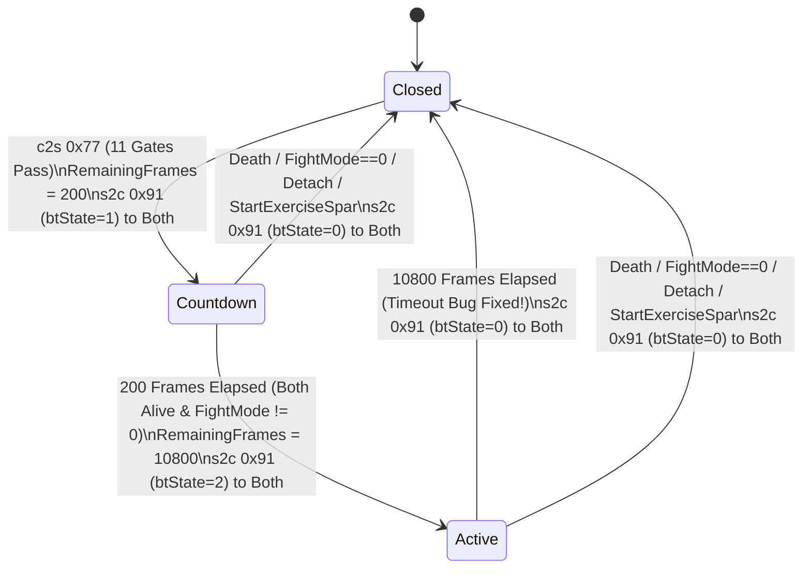
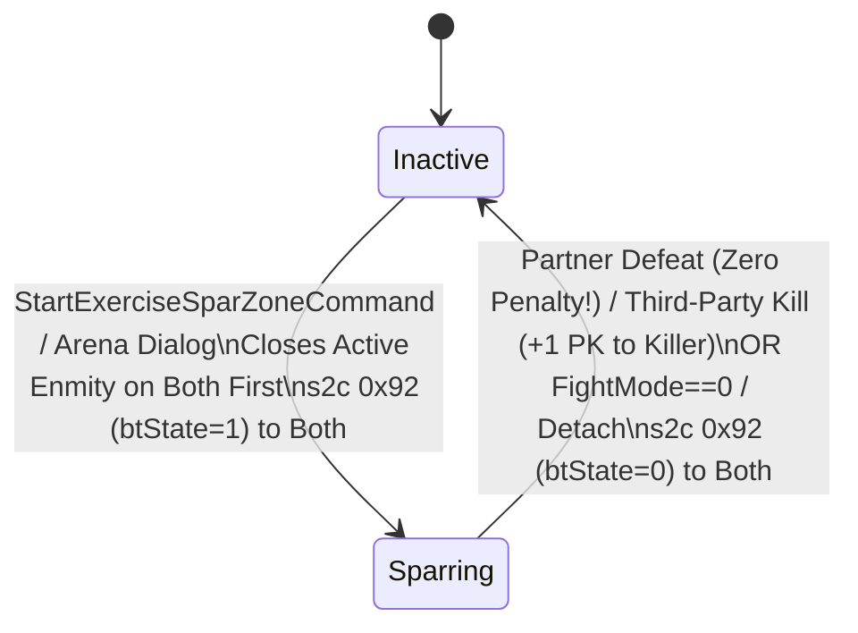
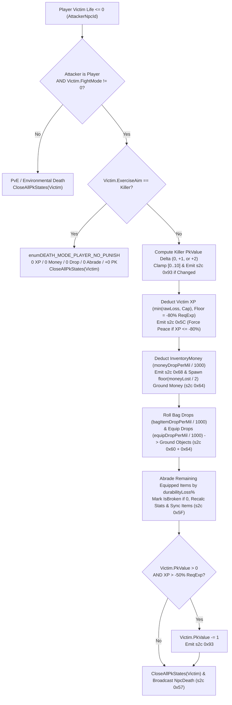

# Data Model: Core PK & Combat Rules (`014-core-pk-combat-rules`)

**Branch**: `014-core-pk-combat-rules` | **Date**: 2026-11-11 | **Spec**: [spec.md](spec.md) | **Research**: [research.md](research.md)

---

## 1. Primitives & Enumerations (`JXReborn.Primitives.Combat`)

### 1.1 `PkEnmityState` (`byte`)
Represents the server-authoritative Enmity (`Cừu sát`) duel lifecycle:
- `Closed = 0` (`enumPK_ENMITY_STATE_CLOSE`): No active or pending Enmity duel.
- `Countdown = 1` (`enumPK_ENMITY_STATE_TIME`): Mandatory `200`-frame (`~11.11s`) warmup countdown; Enmity does **not** yet override `Peace` or same-camp `Fight` relations.
- `Active = 2` (`enumPK_ENMITY_STATE_PKING`): Active `10,800`-frame (`10`-minute) mutual combat; overrides `Peace` and same-camp `Fight` relations (`Enemy`).

### 1.2 `CombatConsts` Additions
- `SwitchToPeaceCooldownFrames = 3240` (`180s` at 18 Hz — already present, overridden by `PkRulesTemplate.SwitchToPeaceCooldownFrames` when loaded).
- `EnmityWarmupFrames = 200` (`PK_ANMITY_TIME`).
- `EnmityActiveDurationFrames = 10800` (`PK_ANMITY_CLOSE_TIME`).
- `MaxPkValue = 10` (`MAX_DEATH_PUNISH_PK_VALUE`).
- `MinFightExpDebtPercent = -80` (`NotFightExpPercent` in `pkrate.ini`).
- `MinEnmityExpDebtPercent = -50` (`NotEnmityExpPercent` & `NotSubPKExpPercent` in `pkrate.ini`).
- `HighLevelPunishExpThresholdLevel = 130` (threshold selecting the high-level max XP loss lookup table `HighLevelMaxExpLossByPkValue`).

---

## 2. Static Game Asset Templates (`JXReborn.GameAssets.PlayerTemplates`)

Compiled from `data/players/progression.players.json` (`pkRules`) into `artifacts/jxreborn-data.pack` via `MemoryPack`:

### 2.1 `PkPenaltyRuleTemplate`
| Property | C# Type | Constraints / Units | Source Mapping |
| :--- | :--- | :--- | :--- |
| `PkValue` | `byte` | `0..10` | `pkRules.penaltiesByPkValue[].pkValue` |
| `ExpLossPerMil` | `int` | `>= 0` (parts per `1,000` of `RequiredLevelExp`) | `pkpunish.txt` col 2 (`10..350`) |
| `MaxExpLoss` | `long` | `>= 0` (standard `Level < 130` cap = `500,000`) | `pkpunish.txt` col 8 (`500000`) |
| `HighLevelMaxExpLoss` | `long` | `>= 0` (`Level >= 130` cap: `500,000..50,000,000`) | Legacy 6.0 `PkValue` `0..10` XP loss ceiling |
| `MoneyDropPerMil` | `int` | `0..1000` (parts per `1,000` of `InventoryMoney`) | `pkpunish.txt` col 3 (`50..1000`) |
| `BagItemDropPerMil` | `int` | `0..1000` (per-item drop roll out of `1,000`) | `pkpunish.txt` col 4 (`0..800`) |
| `EquipDropPerMil` | `int` | `0..1000` (per-slot drop roll out of `1,000`) | `pkpunish.txt` col 5 (`0..1000`) |
| `DurabilityLossPercent` | `int` | `0..100` (`%` of `MaxDurability` abraded) | `pkpunish.txt` col 9 (`0..100`) |

### 2.2 `PkRulesTemplate`
| Property | C# Type | Default | Description |
| :--- | :--- | :--- | :--- |
| `SwitchToPeaceCooldownFrames` | `int` | `3240` | Cooldown in 18-Hz frames (`180s`) to return to `Peace` when `FightMode != 0` |
| `MaxPkValue` | `byte` | `10` | Upper clamp for `PlayerZoneState.PkValue` |
| `EnmityAddPkValue` | `sbyte` | `2` | Killer `PkValue` gain when Enmity launcher kills target (`EnmityPK=2`) |
| `SlaughterAddPkValue` | `sbyte` | `1` | Killer `PkValue` gain for unlawful Slaughter / over-leveled kill |
| `ButcherExerciseAddPkValue` | `sbyte` | `1` | Killer `PkValue` gain when third-party Slaughter kills Sparring player (`ButcherPKExercise=1`) |
| `VictimDeathPkDecay` | `sbyte` | `-1` | Victim `PkValue` delta on punishable PvP death (`BeKilled=-1`) |
| `MinFightExpDebtPercent` | `int` | `-80` | Minimum XP ratio (`%`) required to leave `Peace` & floor for PvP XP loss |
| `MinEnmityExpDebtPercent` | `int` | `-50` | Minimum XP ratio (`%`) required to launch Enmity or receive `-1` PK decay |
| `PenaltiesByPkValue` | `IReadOnlyList<PkPenaltyRuleTemplate>` | `11` rows (`0..10`) | Indexed O(1) lookup by clamped `PkValue` |

---

## 3. In-Memory 18-Hz Zone Entities (`JXReborn.ZoneEngine`)

### 3.1 `PlayerZoneState` Camp & Party Properties
| Property | C# Type | Persistence | Invariant / Semantics |
| :--- | :--- | :--- | :--- |
| `BaseCamp` | `EntityCamp` | Persisted (derived from Faction / Character `Camp`) | Permanent alignment (`Begin = 0`, `Justice = 1`, `Evil = 2`, `Balance = 3`). Never overwritten by temporary PK flag (`0x54`). |
| `CurrentCamp` | `EntityCamp` | Transient (initialized to `BaseCamp` on attach) | Effective combat camp broadcast in `0x4C`, `0x4D`, and `0x58`. Equals `EntityCamp.Free` (`4`) while temporary PK camp flag is enabled on a non-novice player; restored to `BaseCamp` when disabled or when joining/changing sect. |
| `PartyId` | `uint` | Transient (`0` = no party) | Non-zero identifier shared by active party teammates; grants mutual PvP immunity (`Friend`) in `EvaluateRelation`. |
| `PkState` | `PlayerPkMode` | Persisted (`Character.PkState`) | Normal PK stance (`Peace = 0`, `Fight = 1`, `Slaughter = 2`). |
| `PkValue` | `sbyte` | Persisted (`Character.PkValue`) | Criminal murder counter clamped to `[0, 10]`. |
| `LastPkModeChangeTick` | `long` | Transient | 18-Hz frame tick when `PkState` last changed out of `Peace` (or between `Fight`/`Slaughter`). |

### 3.2 `PlayerPkSessionState` (`IPlayerFeatureSlot`)
Stored in `PlayerZoneState`'s zero-allocation `IPlayerFeatureSlot` array via `PlayerFeatureSlotKey<PlayerPkSessionState>`:

| Property | C# Type | Initial Value | Semantics |
| :--- | :--- | :--- | :--- |
| `EnmityState` | `PkEnmityState` | `PkEnmityState.Closed` | `Closed (0)`, `Countdown (1)`, or `Active (2)` |
| `EnmityAimCharacterId` | `Guid` | `Guid.Empty` | Opponent's `CharacterId` (empty when `Closed`) |
| `EnmityAimNpcId` | `uint` | `0` | Opponent's runtime `NpcId` for wire sync |
| `EnmityRemainingFrames` | `int` | `0` | `200..1` during `Countdown`; `10800..1` during `Active` |
| `IsEnmityLauncher` | `bool` | `false` | `true` on the initiator (`+2` PK on kill), `false` on the target (`+0` PK on self-defense kill) |
| `IsExercising` | `bool` | `false` | `true` while in an active 1v1 Sparring match |
| `ExerciseAimCharacterId` | `Guid` | `Guid.Empty` | Sparring partner's `CharacterId` |
| `ExerciseAimNpcId` | `uint` | `0` | Sparring partner's runtime `NpcId` |
| `PendingSparTargetCharacterId` | `Guid` | `Guid.Empty` | Optional transient challenge proposal target for `ArenaSparringMasterDialogScript` |
| `PendingSparExpiryTick` | `long` | `0` | Expiration tick (e.g., `+540` frames = `30s`) for unanswered Arena Sparring challenge |

**Lifecycle Hook (`OnPlayerDetached`)**:
When `PlayerZoneState` detaches from `MapZoneWorker` for any `PlayerDetachReason` (`CleanLogout`, `SocketClosed`, `HeartbeatTimeout`, `LeaseSuperseded`, `MapTransferred`), `PlayerPkSessionState.OnPlayerDetached` invokes `context.Worker.CloseAllPkStates(player)`, immediately clearing any active Enmity or Sparring on the remaining in-zone opponent and sending `0x91` (`btState = 0`) / `0x92` (`btState = 0`).

### 3.3 `PkRelationContext` (`readonly record struct`)
Stack-allocated value struct passed to `CombatDamageCalculator.EvaluateRelation` by both `MapZoneWorker` (immediate skills) and `MissileSimulationTickSystem` (projectile impacts):

```text
PkRelationContext(
    Guid CharacterId,
    uint RuntimeNpcId,
    EntityCamp BaseCamp,
    EntityCamp CurrentCamp,
    byte FightMode,
    PlayerPkMode PkMode,
    uint PartyId,
    PkEnmityState EnmityState,
    Guid EnmityAimCharacterId,
    bool IsExercising,
    Guid ExerciseAimCharacterId)
```

---

## 4. Authoritative State Machines

### 4.1 Normal PK Mode State Machine (`0x76` $\rightarrow$ `0x90`)



### 4.2 Targeted Enmity State Machine (`0` $\rightarrow$ `1` $\rightarrow$ `2` $\rightarrow$ `0`)



### 4.3 1v1 Sparring (`Exercise`) State Machine (`0` $\leftrightarrow$ `1`)



---

## 5. PvP `DeathPunish` Resolution Flow


