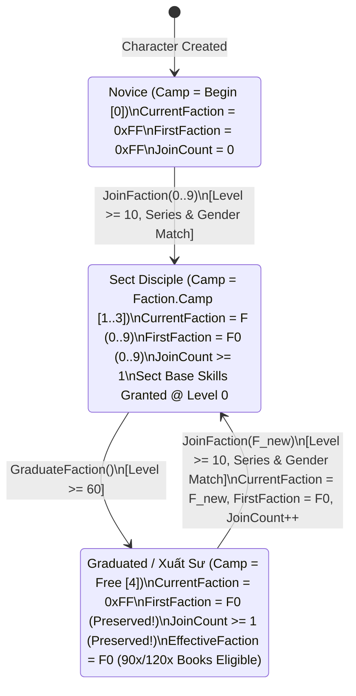

# Data Model: Factions, Skill Trees & Point Washing (`015-core-factions-and-skills`)

**Date**: 2026-11-11  
**Compliance**: Constitution `v1.4.0` (`JX Reborn Data Standard v1`, 1 type per file, `sealed` concrete classes, strict Zone vs. ORM separation).

---

## 1. Static Game Asset Models (`JXReborn.GameAssets`)

### 1.1 `FactionRankTitleTemplate`
**File**: `src/JXReborn.GameAssets/PlayerTemplates/FactionRankTitleTemplate.cs`  
Immutable `MemoryPackable` record representing one rank title row from `data/players/progression.players.json` (`factions[*].titles[*]`), derived from `settings/factiontitle.txt`.

| Property | Type | Constraints | Description |
| :--- | :--- | :--- | :--- |
| `Rank` | `byte` | `1..10` | 1-based rank tier within the sect (`1` lowest initiate, `10` sect leader). |
| `MaleTitle` | `string` | Non-empty UTF-8 | Title displayed for male disciples at this rank (may be empty for female-only sects). |
| `FemaleTitle` | `string` | Non-null UTF-8 | Title displayed for female disciples at this rank (empty for male-only Shaolin). |

### 1.2 `FactionTemplate`
**File**: `src/JXReborn.GameAssets/PlayerTemplates/FactionTemplate.cs`  
Immutable `MemoryPackable` record representing a martial arts sect definition from `data/players/progression.players.json` (`factions[*]`).

| Property | Type | Constraints | Description |
| :--- | :--- | :--- | :--- |
| `Id` | `byte` | `0..10` (`0..9` classic active) | Canonical numeric sect identifier (`0` Thiếu Lâm .. `9` Côn Lôn; `10` Hoa Sơn inactive). |
| `Code` | `string` | `kebab-case`, unique | Canonical string identifier (`thieu-lam-phai` .. `con-lon-phai`). |
| `Name` | `string` | Non-empty UTF-8 | Localized Vietnamese sect display name. |
| `Series` | `byte` | `0..4` (`FiveElementsSeries`) | Required character Five-Elements series (`0` Metal, `1` Wood, `2` Water, `3` Fire, `4` Earth). |
| `Camp` | `byte` | `1..3` (`EntityCamp`) | Sect alignment camp (`1` Justice, `2` Evil, `3` Balance). |
| `AllowedGenders` | `IReadOnlyList<byte>` | Subset of `[0, 1]` | Permitted character genders (`[0]` Male-only, `[1]` Female-only, `[0, 1]` Both). |
| `SkillIds` | `IReadOnlyList<int>` | Positive `SkillTemplate.Id`s | Base sect skill IDs granted at `BaseLevel = 0` upon sect induction. |
| `Titles` | `IReadOnlyList<FactionRankTitleTemplate>` | Ordered by `Rank` | Sect rank titles aligned to `factiontitle.txt` custom faction mapping. |

### 1.3 `IPlayerTemplateCatalog` & `GameAssetsSnapshotBundle` Extensions
- `IPlayerTemplateCatalog` / `PlayerTemplateCatalog` adds:
  - `IReadOnlyList<FactionTemplate> AllFactions { get; }`
  - `bool TryGetFactionById(byte factionId, out FactionTemplate? faction)`
  - `bool TryGetFactionByCode(string code, out FactionTemplate? faction)`
  - `bool TryGetStarterTemplate(byte series, byte gender, out PlayerStarterTemplate? starter)`
- `GameAssetsSnapshotBundle` adds `IReadOnlyList<FactionTemplate>? Factions = null` and compiles `players.pack` via `MemoryPackSnapshotCompiler`.

---

## 2. Shared Primitives (`JXReborn.Primitives`)

### 2.1 `CharacterConsts` Additions
**File**: `src/JXReborn.Primitives/Characters/CharacterConsts.cs`

| Constant | Type | Value | Purpose |
| :--- | :--- | :--- | :--- |
| `NoFactionId` | `byte` | `0xFF` (`255`) | Unaffiliated / graduated current or first sect sentinel (already present). |
| `ClassicFactionCount` | `byte` | `10` | Active classic martial arts sects (`0..9`); sects `>= 10` are rejected for induction/books. |
| `MinFactionJoinLevel` | `ushort` | `10` | Minimum character level required to join a sect (`FR-002`). |
| `MinFactionGraduateLevel` | `ushort` | `60` | Minimum character level required to graduate from a sect (`FR-004`). |
| `MinMarrowWashLevel` | `ushort` | `50` | Minimum character level required for attribute or skill point washing (`FR-011`, `FR-012`). |
| `MinAdvancedBookLevel` | `ushort` | `80` | Minimum character level for 90x skill books, *Võ Lâm Mật Tịch*, and *Tẩy Tủy Kinh*. |
| `MinSkill120BookLevel` | `ushort` | `120` | Minimum character level for the Level 120 sect skill book (`FR-016`). |
| `MaxBonusBookUses` | `int` | `15` | Per-character cap for *Võ Lâm Mật Tịch* and *Tẩy Tủy Kinh* (`FR-017`, `FR-018`). |
| `XiSuiJingBonusPointsPerBook` | `int` | `5` | Flat `+5` unallocated attribute points granted per *Tẩy Tủy Kinh* (`Session 2026-11-11`). |
| `WuLinMiJiTaskId` | `ushort` | `80` | Persistent quest/task slot storing *Võ Lâm Mật Tịch* count in low nibble (`bits 0..3`). |
| `XiSuiJingTaskId` | `ushort` | `81` | Persistent quest/task slot storing *Tẩy Tủy Kinh* count in low nibble (`bits 0..3`). |
| `BonusBaseAttrTaskId` | `ushort` | `88` | Persistent quest/task slot storing per-byte single-stat quest bonuses (`Str/Dex/Vit/Eng`). |
| `Skill120BookTaskId` | `ushort` | `2463` | Persistent quest/task slot storing learned Level 120 `SkillId` (`0` = not yet used). |

---

## 3. Control-Plane Persistence & Snapshot Contracts (`Contracts`, `Domain`, `Application`)

### 3.1 `CharacterSkillSnapshotDto` & `CharacterSkillDto` / `CharacterSkillValue`
- **New DTO**: `src/JXReborn.Contracts/Characters/CharacterSkillSnapshotDto.cs`
  ```csharp
  public sealed record CharacterSkillSnapshotDto(
      int SkillId,
      ushort BaseLevel,
      byte ExpPercent = 0,
      uint SkillExp = 0);
  ```
- **Updated Domain Value Object**: `src/JXReborn.Domain/Characters/CharacterSkillValue.cs`
  - Stores `int SkillId`, `ushort BaseLevel` (**now permits `BaseLevel >= 0`** instead of requiring `> 0`), `byte ExpPercent`, and `uint SkillExp = 0`.
- **Updated Read DTO**: `src/JXReborn.Contracts/Characters/CharacterSkillDto.cs`
  - Adds `uint SkillExp = 0` so `MapZoneWorker` restores exact raw proficiency experience on zone attach.

### 3.2 `UpdateCharacterWorldSnapshotDto` & `Character.UpdateWorldSnapshot`
**Files**:
- `src/JXReborn.Contracts/Characters/UpdateCharacterWorldSnapshotDto.cs`
- `src/JXReborn.Domain/Characters/Character.cs`
- `src/JXReborn.Application/Characters/CharacterAppService.cs`

Added optional write-behind snapshot fields:

| Field | Type | Validation / Invariant |
| :--- | :--- | :--- |
| `CurrentFactionId` | `byte?` | Either `0xFF` (`NoFactionId`) or `< ClassicFactionCount` (`0..9`). |
| `FirstFactionId` | `byte?` | `0xFF` iff `FactionJoinCount == 0`; `< ClassicFactionCount` (`0..9`) whenever `FactionJoinCount > 0`. |
| `FactionJoinCount` | `ushort?` | Monotonically non-decreasing (`>= existing FactionJoinCount`). |
| `LearnedSkills` | `IReadOnlyList<CharacterSkillSnapshotDto>?` | Replaces character skill collection preserving `BaseLevel == 0` entries and `uint SkillExp`. |

---

## 4. Zone Simulation State (`JXReborn.ZoneEngine`)

### 4.1 `LearnedSkillSlot`
**File**: `src/JXReborn.ZoneEngine/PlayerSessions/LearnedSkillSlot.cs`

| Field | Type | Description |
| :--- | :--- | :--- |
| `SkillId` | `int` | Positive `SkillTemplate.Id`. |
| `BaseLevel` | `ushort` | Point-allocated or book-granted base level (`0..63`, excludes equipment `+AllSkills` bonus). |
| `SkillExp` | `uint` | Raw accumulated proficiency experience for `IsExpSkill == true` skills (`0` for point-allocated skills). |

### 4.2 `PlayerZoneState` Faction & Skill Extensions
**File**: `src/JXReborn.ZoneEngine/PlayerSessions/PlayerZoneState.cs`

| Property / Method | Type | Invariant / Behavior |
| :--- | :--- | :--- |
| `CurrentFactionId` | `byte` | Active sect (`0..9`) or `0xFF` (`NoFactionId`). |
| `FirstFactionId` | `byte` | First joined sect (`0..9`) or `0xFF` if never inducted. |
| `FactionJoinCount` | `ushort` | Number of sect inductions (`0` for pure novice, `>= 1` once inducted). |
| `EffectiveFactionId` | `byte` | Computed: `CurrentFactionId != CharacterConsts.NoFactionId ? CurrentFactionId : FirstFactionId`. |
| `BaseCamp` | `byte` | Persistent camp (`0` Begin, `1` Justice, `2` Evil, `3` Balance, `4` Free) — aligned with Spec `014`. |
| `CurrentCamp` | `byte` | Runtime camp (`0..4`), initialized equal to `BaseCamp` on attach/join/graduate. |
| `BonusSkillLevels` | `byte` | Equipment `+AllSkills` bonus added to `BaseLevel > 0` skills when computing effective level. |
| `LearnedSkills` | `IReadOnlyDictionary<int, LearnedSkillSlot>` | Authoritative in-zone skill book; retains `BaseLevel == 0` slots. |

---

## 5. Persistent Task Variable Bit-Packing (`TaskValues`)

| Task ID | Constant | Bit Layout | Range & Semantics |
| :-: | :--- | :--- | :--- |
| `80` | `WuLinMiJiTaskId` | `bits [0..3]` (`val & 0xF`) | Count of *Võ Lâm Mật Tịch* consumed (`0..15`). Upper bits `val & ~0xF` MUST be preserved on write: `newVal = (oldVal & ~0xF) \| (count + 1)`. |
| `81` | `XiSuiJingTaskId` | `bits [0..3]` (`val & 0xF`) | Count of *Tẩy Tủy Kinh* consumed (`0..15`). Each use grants flat `+5` `UnallocatedAttributePoints`. Upper bits `val & ~0xF` MUST be preserved on write. |
| `88` | `BonusBaseAttrTaskId` | `byte 0`: Str, `byte 1`: Dex, `byte 2`: Vit, `byte 3`: Eng | Permanent single-stat quest rewards (`(val >> (8 * idx)) & 0xFF`) added to starter base stats during `WashAttributes`. |
| `2463` | `Skill120BookTaskId` | Full `int32` | `0` if character has never used a Level 120 Skill Book; set to granted `SkillId` (`708..717`) upon consumption. |

---

## 6. Faction & Camp Lifecycle State Machine



---

## 7. `WashPoints` Mathematical Conservation Invariants

### 7.1 Attribute Point Conservation (`WashAttributes`)
For any character of `Series` $s \in \{0..4\}$, `Gender` $g \in \{0,1\}$, `Level` $L \ge 50$, consumed *Tẩy Tủy Kinh* count $k_{81} = \text{Task}[81] \ \& \ \text{0xF} \in \{0..15\}$, and quest stat byte bonuses $(q_{\text{str}}, q_{\text{dex}}, q_{\text{vit}}, q_{\text{eng}})$ from $\text{Task}[88]$:

1. **Minimum Baseline per Attribute**:
   $$B_i = \text{StarterBase}(s, g)_i + q_i \quad \text{for } i \in \{\text{Str}, \text{Dex}, \text{Vit}, \text{Eng}\} \quad \left(\sum_i \text{StarterBase}(s, g)_i = 100\right)$$
2. **Refund Calculation**:
   $$\Delta_i = \max(0, A_i - B_i), \qquad A'_i = A_i - \Delta_i, \qquad U'_{\text{attr}} = U_{\text{attr}} + \sum_{i} \Delta_i$$
3. **Exact Conservation Invariant**:
   $$U'_{\text{attr}} + \sum_i A'_i = U_{\text{attr}} + \sum_i A_i = 100 + 5(L - 1) + 5 \cdot k_{81} + \sum_i q_i + P_{\text{other}}$$
   Every single point—including all $5 \cdot k_{81}$ bonus points from *Tẩy Tủy Kinh*—is 100% conserved across arbitrary wash cycles.

### 7.2 Skill Point Conservation (`WashSkills`)
Let $\mathcal{P}_{\text{fixed}} = \{1, 2, 53, 210, 229, 230, 231, 232, 400\}$ be the protected starter/utility skill set, and let $\mathcal{E} = \{s \mid \text{SkillTemplate}[s].\text{IsExpSkill} = \text{true}\}$ be the combat-proficiency skill set (all 23 proficiency 90x skills and all 10 120x skills):

1. **Partition of `LearnedSkills`**:
   - **Protected Set** $\mathcal{S}_{\text{keep}} = \{ \text{slot} \in \text{LearnedSkills} \mid \text{slot.SkillId} \in \mathcal{P}_{\text{fixed}} \cup \mathcal{E} \}$: `BaseLevel` and `SkillExp` are **unchanged** (`0` points refunded).
   - **Washable Set** $\mathcal{S}_{\text{wash}} = \text{LearnedSkills} \setminus \mathcal{S}_{\text{keep}}$: Every slot remains in `LearnedSkills` with `BaseLevel' = 0, SkillExp' = 0`.
2. **Refund & Conservation Invariant** (with $k_{80} = \text{Task}[80] \ \& \ \text{0xF} \in \{0..15\}$ *Võ Lâm Mật Tịch* uses):
   $$U'_{\text{skill}} = U_{\text{skill}} + \sum_{\text{slot} \in \mathcal{S}_{\text{wash}}} \text{slot.BaseLevel} = (L - 1) + k_{80} + P_{\text{other\_skill}}$$
3. **Active Aura Invariant**:
   If `ActiveAuraSkillId` $\in \{ \text{slot.SkillId} \mid \text{slot} \in \mathcal{S}_{\text{wash}} \land \text{slot.BaseLevel} > 0 \}$, then `ActiveAuraSkillId' = 0`.
